<div align="center">

# 🐾 PetFlow — B2B Multi-Tenant SaaS Platform

**Enterprise-grade management system for pet shops, grooming salons, and veterinary aesthetics.**

[](https://nextjs.org/)
[](https://www.typescriptlang.org/)
[](https://tailwindcss.com/)
[](https://www.prisma.io/)
[](https://vitest.dev/)
[](https://github.com/jhonwictordev/petflow)

</div>

---

## 📌 Executive Summary

**PetFlow** is a commercial-grade, scalable multi-tenant SaaS application designed to centralize and automate the entire operational, scheduling, customer relationship, and financial routine of pet care businesses.

Built as a modular monolith adhering to domain-driven principles, PetFlow eliminates operational blind spots, double-booking conflicts, and revenue leakage while delivering an ultra-modern user experience.

---

## 🚀 Key Functional Modules

### 1. 📅 Atomic Conflict-Free Smart Scheduling
- **Zero-Conflict Guarantee**: Validates professional time overlap inside an atomic database transaction before booking.
- **Dynamic Duration & Sizing**: Automatically adjusts appointment slots according to the animal's breed and size (Small, Medium, Large, Giant).
- **Real-Time Operational Lifecycle**: `AGENDADO` ➔ `CONFIRMADO` ➔ `EM_ATENDIMENTO` ➔ `CONCLUIDO` (with `CANCELADO` and `FALTOU` audit tracks).
- **Front-Desk Settlement**: Direct payment collection (PIX, Credit Card, Debit Card, Cash) right from the calendar interface.

### 2. 🛡️ Strict Multi-Tenant Architecture & RBAC
- **Server-Enforced Isolation**: Every query and mutation is strictly scoped to the verified `tenantId` resolved from cryptographic HTTP-Only session cookies.
- **Granular Permissions Matrix**:
  - `OWNER`: Full administrative, corporate, financial, and team authority.
  - `MANAGER`: Complete operational control over agenda, services, clients, inventory, and staff.
  - `RECEPTIONIST`: Front-desk appointments, check-in, customer onboarding, and point-of-sale payments.
  - `EMPLOYEE`: Operational view of personal and salon appointments without financial exposure.
  - `SUPERADMIN`: Platform-wide governance, subscription limits, MRR tracking, and tenant lifecycle management.

### 3. 💰 Accurate Financial Engine
- **Integer Cents Precision**: All financial records, receivables, costs, and revenues are calculated as exact integers (`Int` cents), eliminating IEEE-754 floating-point inaccuracies.
- **Operational Cash Flow**: Segregates realized cash revenue from outstanding appointments and accounts payable.
- **Groomer Commissions**: Automated commission rates computed per professional and service performed.

### 4. 📦 Inventory Control & Immutable Movement Ledger
- **Audit-Logged Stock Moves**: Every stock transaction (`ENTRADA`, `SAIDA`, `AJUSTE`) is recorded with previous balance, new balance, timestamps, and the authenticated actor.
- **Stock Depletion Safeguards**: Database transaction constraints prevent negative inventory balances.
- **Low-Stock Triggers**: Proactive dashboard warnings when products hit minimum safety levels.

### 5. 🎟️ Pet Service Packages & Recurring Credits
- **Customer Care Plans**: Sell multi-use service packages (e.g., 4 monthly baths).
- **Automated Ledger**: Auto-deducts credits upon check-in, tracking validity expiration dates and remaining balances.

### 6. 🌐 Public Experience & Portals
- **Commercial Landing Page**: High-converting showcase with live feature previews, transparent pricing tiers (Starter, Pro, Business), and customer onboarding flow.
- **Customer Self-Service Portal (`/portal`)**: Allows pet owners to check upcoming appointments, vaccination/care notes, and package credit balances using their verified phone number.
- **Super Admin Platform (`/superadmin`)**: Platform control tower displaying aggregated MRR, subscription distributions, and safe suspension controls.

---

## 🔒 Comprehensive Cybersecurity Hardening

PetFlow incorporates defense-in-depth cybersecurity controls across presentation, transport, session, and database layers:

```mermaid
flowchart LR
    ClientReq["Client Request"] --> RateLimit["Sliding Window Rate Limiter"]
    RateLimit --> SecHeaders["HTTP Security Headers (CSP, HSTS)"]
    SecHeaders --> SessionGuard["Encrypted JWT & HTTP-Only Cookie"]
    SessionGuard --> Sanitizer["Input Sanitization & Anti-XSS"]
    Sanitizer --> TenantShield["Tenant Boundary Guard"]
    TenantShield --> ParamQuery["Prisma Parameterized Query"]
    ParamQuery --> DB[(Secure Database)]
```



1. **HTTP Security Headers (`next.config.mjs`)**:
   - `Content-Security-Policy`: Restricts scripts, styles, fonts, and prohibits `frame-ancestors` (complete anti-clickjacking protection).
   - `X-Frame-Options: DENY`: Blocks framing and UI redressing attacks.
   - `X-Content-Type-Options: nosniff`: Prevents MIME-confusion attacks.
   - `Strict-Transport-Security: max-age=63072000; includeSubDomains; preload` (HSTS).
   - `Permissions-Policy`: Disables unused hardware access (camera, microphone, geolocation).
   - `poweredByHeader: false`: Obscures server fingerprinting headers.

2. **Anti-Brute Force Rate Limiting (`src/lib/rateLimit.ts`)**:
   - Sliding-window algorithm protects sensitive endpoints (`/api/auth/login`) by restricting excessive consecutive attempts per IP and target identity, returning `HTTP 429 Too Many Requests`.

3. **Input Sanitization & Injection Defense (`src/lib/sanitization.ts`)**:
   - Strips malicious script tags, inline event attributes (`onerror`, `onload`), null-byte injections (`\0`), and harmful URI schemes (`javascript:`).

4. **Cryptographic Integrity & Session Security (`src/lib/auth.ts`)**:
   - Password hashing utilizing `bcryptjs` with 10 salt rounds.
   - Ephemeral cryptographically random fallback in development (`crypto.randomBytes(32)`).
   - Production requirement enforcing high-entropy `JWT_SECRET` with $\ge 32$ characters.
   - Cookies configured with `HttpOnly: true`, `SameSite: Lax`, and `Secure: true` in production.

---

## 🛠️ Technology Stack

| Layer | Technology | Details |
|---|---|---|
| **Frontend Framework** | **Next.js 14.2 (App Router)** | Server Components, Streaming, Optimized Bundles |
| **Language** | **TypeScript 5.6** | Strict type-safety across client and server |
| **Styling & Components**| **Tailwind CSS + shadcn/ui** | Custom design system tokenized for accessibility |
| **Icons** | **Lucide Icons** | Clean SVG iconography |
| **Visual Analytics** | **Recharts** | Interactive revenue charts and distribution graphs |
| **Database ORM** | **Prisma ORM 5.22** | Strongly-typed relational schema and migrations |
| **Data Storage** | **PostgreSQL / SQLite** | High-performance relational storage |
| **Security** | **Bcrypt.js + JSONWebToken** | Industry-standard password hashing and sessions |
| **Testing Engine** | **Vitest 2.1** | Fast automated unit, integration, and security tests |

---

## 🧪 Automated Test Suite (22/22 Passing)

PetFlow includes 6 automated test suites executing 22 regression and security tests:

```bash
 ✓ tests/inventory-movements.test.ts (3 tests)
 ✓ tests/scheduling-conflicts.test.ts (4 tests)
 ✓ tests/cybersecurity.test.ts (3 tests)
 ✓ tests/multi-tenant-isolation.test.ts (3 tests)
 ✓ tests/financial-integrity.test.ts (2 tests)
 ✓ tests/auth-rbac.test.ts (7 tests)

Test Files  6 passed (6)
     Tests  22 passed (22)
```

Run tests locally:
```bash
npm run test
```

---

## ⚡ Quickstart & Local Installation

### Prerequisites
- Node.js `v20+` or `v24+`
- npm `v10+`

### 1. Clone & Install
```bash
git clone https://github.com/jhonwictordev/petflow.git
cd petflow
npm install
```

### 2. Initialize Database & Seed Demo Data
```bash
npx prisma db push
node scripts/seed.mjs
```

### 3. Start Development Server
```bash
npm run dev
```

Open [http://localhost:3000](http://localhost:3000) in your browser.

---

## 🔑 Demo Access Credentials

The demo database is pre-seeded with realistic records and 1-click test credentials accessible on the `/login` screen:

| Role | Email | Password | Scope |
|---|---|---|---|
| **Owner (Demo Pet Shop)** | `owner@petflowdemo.com.br` | `demoPassword123!` | Full salon management, finances, team, and stock |
| **Operational Manager** | `gerente@petflowdemo.com.br` | `demoPassword123!` | Operational oversight of schedule, clients, and services |
| **Front-Desk Receptionist** | `recepcao@petflowdemo.com.br` | `demoPassword123!` | Check-in, counter payments, customer booking |
| **Isolated Tenant (AuAu)** | `owner@auaupet.com.br` | `demoPassword123!` | Competitor tenant validating strict data isolation |
| **Global Super Admin** | `admin@petflow.com.br` | `adminPassword123!` | SaaS platform control tower, tenant plans, and MRR metrics |

---

## 📄 License

Distributed under the MIT License. Developed for commercial SaaS applications.
